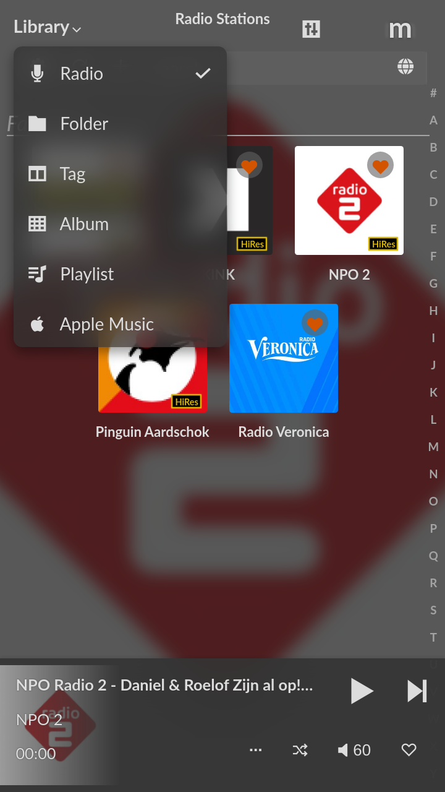
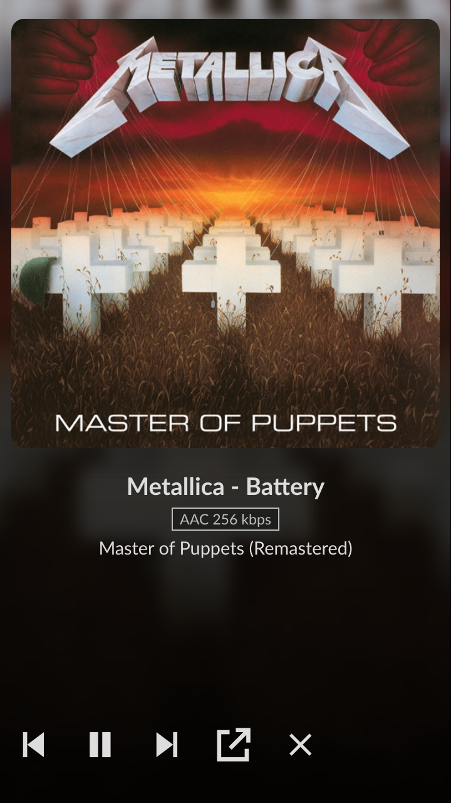
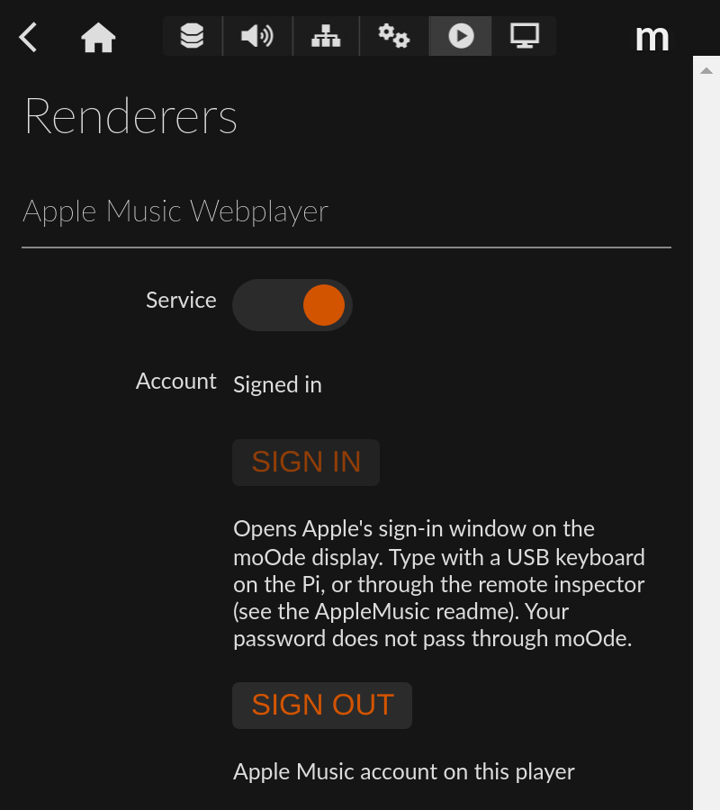
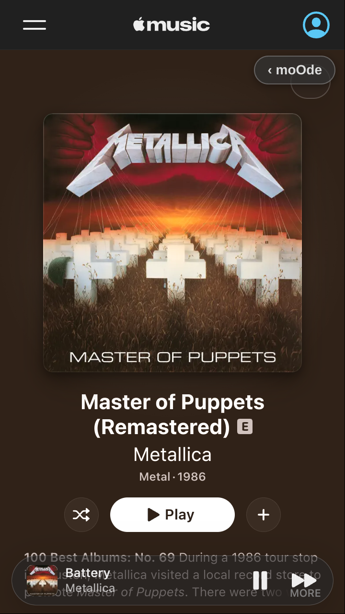
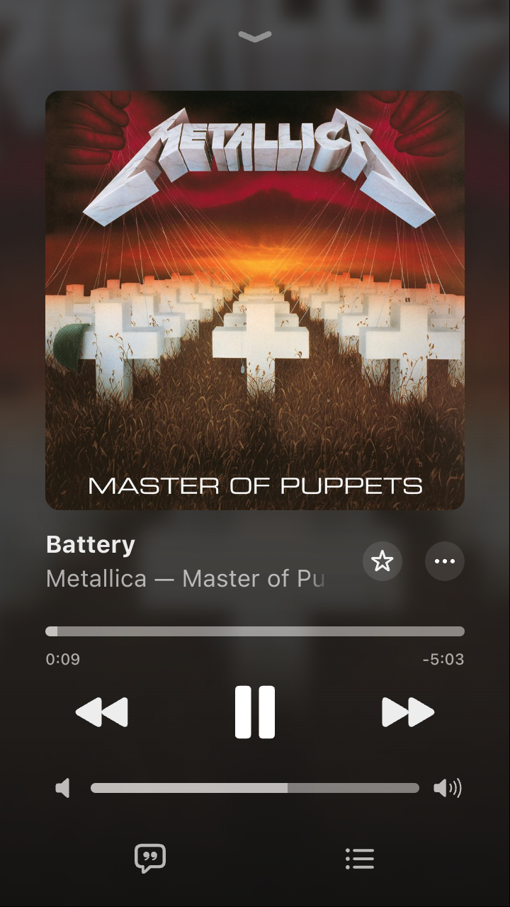
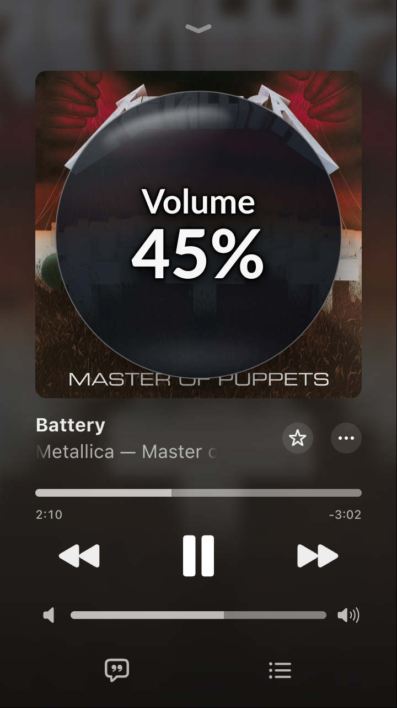

# Apple Music for moOde Audio

This project adds **Apple Music** to moOde's Library view menu, next to Radio,
Folder, Tag, Album and Playlist. Choosing it opens Apple Music Web full screen
on the Raspberry Pi's local display. A small **‹ moOde** button in Apple Music
returns to the moOde interface while the music keeps playing. Phones and
computers show Apple Music on moOde's renderer screen, like AirPlay or Spotify
Connect, with cover, title and play/pause/next/previous buttons.

<p>
  
  
</p>
<sub>Left: <b>Apple Music</b> in moOde's Library view menu. Right: moOde's renderer screen on a phone while Apple Music plays on the Pi, with previous, play/pause, next, show Apple Music and close buttons.</sub><br><br>

Audio from Apple Music is sent to moOde's `_audioout` ALSA device, so it follows
the same output chain as MPD: with CamillaDSP enabled the sound passes through
your CamillaDSP configuration before reaching the DAC/HAT (tested with the
Audiophonics DigiPi+ / HiFiBerry Digi driver).

Apple Music runs in a separate Chromium profile
(`~/.config/moode-applemusic`). moOde clears its own browser profile every time
the local display starts; the separate profile keeps you signed in.

## Requirements

- moOde with the local display enabled (tested on moOde 10.3.7, Pi 4 2 GB,
  Touch Display 2 at 720 × 1280)
- an Apple Music subscription
- Widevine (`libwidevinecdm0` from the Raspberry Pi repository) and `xdotool`;
  the installer installs them when missing

## Install

```sh
cd ~/moOdeAudioProjects/AppleMusic
sudo sh ./install.sh
```

The installer:

1. installs `libwidevinecdm0` and `xdotool` if they are not installed yet (and
   remembers that);
2. installs `/usr/local/bin/moode-applemusic` (launcher), the Chromium
   extension in `/opt/moode-applemusic/extension` and the settings file
   `/etc/default/moode-applemusic`;
3. installs `/var/www/applemusic.php` and `/var/www/js/applemusic.js`;
4. adds one marked include block to `/var/www/header.php`
   (backup in `/var/backups/moode-applemusic/`);
5. restarts the local display.

Run the installer again after a moOde update that replaces `header.php`.

## Renderers page

moOde's **Configure → Renderers** gets an **Apple Music Webplayer** block,
like AirPlay or Spotify Connect:

- **Service** ON/OFF. Off closes Apple Music and removes it from the Library
  menu; the launcher refuses to open it (`APPLEMUSIC_ENABLED=no`).
- **Account**: *Signed in* or *Not signed in*, as reported by Apple Music
  (known once Apple Music has been opened since the Pi started).
- **Sign in** opens Apple's own sign-in window on the moOde display; **Sign
  out** signs this player out of Apple Music (after a confirmation). Your
  Apple Account password never passes through moOde.


<br><sub>The Apple Music Webplayer block on Configure → Renderers.</sub><br><br>

## Sign in (once)

Choose **Sign in** on the Renderers page (or **Log in** in Apple Music). The
local display has no keyboard: either plug in a USB keyboard once, or type
from your computer through Chromium's remote inspector:

1. Open Apple Music on the Pi with remote debugging, and tunnel the port:

   ```sh
   ssh -L 9222:localhost:9222 mischa@moode.local "sudo moode-applemusic close; sudo moode-applemusic open --debug; sleep 1800"
   ```

2. On the computer open `edge://inspect` or `chrome://inspect`, click
   **Configure…**, add `localhost:9222`, then click **inspect** below
   *Apple Music*. The screencast in DevTools accepts mouse and keyboard
   input: click **Log in** and sign in with your Apple Account.
3. Close Apple Music with **‹ moOde** and stop the ssh command. Later starts
   from the moOde menu run without remote debugging.

## Use

- moOde Library menu → **Apple Music**: stops MPD playback and opens Apple Music
  on the local display (or shows it again at once when it is already
  running). Selecting it from a phone or computer browser opens Apple Music on
  the Pi's screen as well.
- **‹ moOde** (top right in Apple Music): back to the normal moOde
  interface. Apple Music keeps running and playing in the background; choose
  Library menu → **Apple Music** to return to it at once. The button is
  hidden while the full-screen player is open, where Apple Music has its own
  buttons.
- **Full-screen player opens by itself** when something new starts that you
  chose: a tap on an album, playlist, station or song, or a click with the
  Siri Remote. Not for the next song of an album, resuming a paused song, or
  the mini player's own buttons.
- **Swipe down** on the full-screen player closes it, as in the phone app
  (Apple Music Web only offers this gesture on phones).
- Command line: `sudo moode-applemusic open | hide | show | close | toggle | status | enable | disable`.

<p>
  
  
</p>
<sub>Apple Music on the 720 × 1280 Touch Display 2 with a dark moOde theme. Left: an album page with the <b>‹ moOde</b> button and the mini player. Right: the full-screen player with moOde's blurred cover backdrop.</sub><br><br>

### Apple Music in moOde

While Apple Music runs, moOde on phones and computers shows it on moOde's
renderer screen, the same screen moOde uses for AirPlay and Spotify Connect:
cover, artist, title, album, an *Apple Music · AAC 256 kbps* badge and the
output format. The Pi's own display does not: there Apple Music's own player
is the player, and **‹ moOde** leads to the normal moOde interface. Buttons of
the renderer screen:

| Button | Action |
|---|---|
| ⏮ ⏯ ⏭ | previous (restarts the song after 3 s) / play-pause / next |
| ↗ | show Apple Music on the Pi's screen |
| ✕ | close Apple Music |

The Apple Music extension reports what plays once a second to
`applemusic.php` (state in `/dev/shm`, not on the SD card). That request
waits up to 0.9 s for a button press, so presses in moOde or on a remote
reach Apple Music within ~50 ms.

MPD and Apple Music share the output device; whichever starts last wins:

- Apple Music starts playing: MPD is stopped.
- Play is pressed in moOde (MPD) while Apple Music plays: Apple Music pauses
  and MPD starts. After a pause Chromium keeps the audio device open for
  ~15 s; to free it at once, the launcher restarts Chromium's audio process
  (`moode-applemusic release-audio`, done within a second). Apple Music then
  shows an error message, which the extension closes; the next play in Apple
  Music works normally.

### moOde theme

Apple Music follows the theme chosen in moOde (**Preferences → Appearance**):

- light or dark Apple Music, like the theme's text colour (dark themes such as
  Default give a dark Apple Music);
- the theme's background colour for pages, navigation, mini player and
  full-screen player;
- moOde's accent colour for Apple Music's buttons and highlights;
- with moOde's *Cover backdrop* on, the full-screen player shows the cover
  blurred behind it, with moOde's blur and scale settings (static, no extra
  CPU load).

Colour changes are picked up within 30 seconds; a change between a light and
a dark theme applies the next time Apple Music opens.
`APPLEMUSIC_COLOR_SCHEME` (`auto`, `dark`, `light`) overrides light/dark.

### Siri Remote

With the [SiriRemote](../SiriRemote/readme.md) project installed:

- **Play/Pause, Previous/Next** (touchpad click left/right) control Apple
  Music while it is the source: it is on screen, it is playing, or it has a
  song paused and MPD is not playing. Volume keeps controlling moOde's volume
  (CamillaDSP), which also moves Apple Music's slider.
- **Menu/Back** in Apple Music switches between the full-screen player and
  Apple Music's Home page, like moOde's Playback and Library views.
- **Menu/Back twice** returns to moOde and opens its Library source chooser,
  where Apple Music is one of the sources. Within moOde, Menu/Back works as
  usual.
- **Touchpad in Apple Music**, like moOde's Library: a swipe moves a focus
  frame (in moOde's accent colour) over Apple Music's tiles, cards, buttons
  and songs, scrolling along, also through the horizontal rows (tiles to the
  right of the screen included); a touchpad click plays the focused album,
  playlist, station or song at once, without opening its page (touch the
  screen to open an album page). Touching the screen or choosing an item
  removes the frame. In the full-screen player, touchpad left/right are
  Previous/Next.
- In moOde's Playback view, touchpad left/right stay Previous/Next for Apple
  Music while it is the source; other moOde views navigate as usual.
- The remote's on-screen feedback (volume, play/pause, next, battery,
  shutdown countdown) is shown on top of Apple Music too, centred on the
  cover of the full-screen player, in the colours of the moOde theme.


<br><sub>The Siri Remote's volume overlay on top of Apple Music's full-screen player.</sub><br><br>

## Volume

When CamillaDSP is active in moOde, Apple Music's volume slider controls the
**CamillaDSP main volume directly**, like the PassAirplayVolume project:

- Chromium itself always plays at full level (bit-exact into CamillaDSP); the
  slider position is sent to moOde's `/var/www/util/cdsp_volume_update.py`,
  using the same curve and dynamic range as moOde (`/etc/mpd2cdspvolume.config`).
- The slider follows CamillaDSP: turning moOde's volume knob (or a remote)
  while Apple Music is open moves the slider. The current volume is read live
  from CamillaDSP's websocket (port 1234); CamillaDSP's state file is not kept
  up to date while audio is playing, so it is only a fallback.
- moOde's own volume knob level is not changed by the slider. When Apple Music
  closes, the launcher restores it (`vol.sh -restore` and a restart of
  `mpd2cdspvolume`), as moOde does after AirPlay.
- Only volume changes made by touching the slider are sent. Apple Music
  restores its own saved volume on start-up; that value never reaches
  CamillaDSP. On start-up the slider is set to the current CamillaDSP level.

Without CamillaDSP the slider works as a normal browser volume.

## Settings

`/etc/default/moode-applemusic`:

| Setting | Default | Meaning |
|---|---|---|
| `APPLEMUSIC_URL` | `https://music.apple.com/nl/home` | start page |
| `APPLEMUSIC_ALSA_DEVICE` | `_audioout` | ALSA output; `_audioout` follows moOde (CamillaDSP) |
| `APPLEMUSIC_SCALE` | empty | empty = same scale as moOde's display; `1.5` shows more content |
| `APPLEMUSIC_STOP_MPD` | `yes` | stop MPD when Apple Music opens |
| `APPLEMUSIC_FREEZE_MOODE` | `no` | pause moOde's own browser while Apple Music is open (no measurable gain in tests) |
| `APPLEMUSIC_EXTRA_FLAGS` | empty | extra Chromium flags |
| `APPLEMUSIC_COLOR_SCHEME` | `auto` | `auto` = light/dark like the moOde theme, or `dark` / `light` |
| `APPLEMUSIC_ENABLED` | `yes` | service on/off; set by the switch on Configure → Renderers |
| `APPLEMUSIC_LANGUAGE` | empty | interface language, e.g. `en-GB`; the store (catalogue, subscription) stays the one in `APPLEMUSIC_URL`. Empty = the store's own language |

## Performance on the Pi

Apple Music Web plays animated ("motion") artwork everywhere. On a Pi 4 that
video decoding used nearly all CPU, starving CamillaDSP, which caused stutter,
display glitches and playback stopping. The bundled extension therefore:

- blocks motion artwork (`mvod.itunes.apple.com`) and hides its video
  elements, so static covers are shown;
- turns off live blur (`backdrop-filter`) and requests reduced motion;
- refuses WebGL on music.apple.com. The full-screen player otherwise draws an
  animated backdrop at ~40 fps; it now gets a static dark background, and long
  titles no longer scroll.

With this the idle CPU load of Apple Music dropped from ~80–90 % to below 1 %.

Opening the full-screen player went from ~2.5–3 s to ~1–1.5 s after replacing
CSS rules that forced the browser to restyle the whole page (`*` and `:has()`
selectors), and then to ~0.3 s: while the player covers the screen, the page
underneath gets `content-visibility: hidden`, so the browser no longer
restyles it.

Time-synced lyrics blur every line that is not being sung. With lyrics open
that took ~110 % CPU in the page plus ~70 % in Chromium's GPU process, and the
lyrics stuttered (43 fps, frames up to 100 ms). The extension turns that blur
off inside the lyrics' shadow DOM: other lines are dimmed but sharp, the
word-by-word highlight stays, and the lyrics run at 60 fps with ~35 % CPU.

Sections of a page that are off screen (rows of tiles, track lists) get
`content-visibility: auto`, so the browser only renders them when they scroll
into view. Remote navigation right after a page loads went from steps of
1–4 s, with the page drawing about one frame per second for up to 25 s, to
about 50–80 ms per step. Artwork is requested at the size the 720 × 1280
display needs: tiles shown 144 px wide (288 device pixels) were loaded at
592 × 592 and now at 300 × 300, album headers at 480 × 480, large cards at
450 × 600 instead of 900 × 1200 (network rules in the extension).

Apple Music Web also keeps pages you left in memory. After some browsing the
page held ~182 000 DOM nodes while showing ~900, and the Pi got steadily
slower; a reload brings it back to ~12 000. The extension therefore reloads
Apple Music when it has been idle for 10 minutes (no touch input) and nothing
plays. A paused song is kept for 30 minutes; after that the reload clears the
queue.

Tested without gain: the `performance` CPU governor (same timings as
`ondemand`), `--disable-gpu-rasterization`, `--enable-low-end-device-mode`, and
pausing moOde's own browser.

The launcher copies the extension into the Apple Music profile because
Chromium needs a writable extension folder for its network rules. The copy's
folder name contains a hash of the extension files: for an unchanged path
Chromium keeps running a cached version of the extension's service worker.

## Limitations

- Music videos and animated covers do not play (blocked for performance).

- Apple Music Web streams AAC 256 kbps; lossless is not available in the web
  player.
- Apple Music uses an extra ~350–600 MB RAM while running, also in the
  background. Close it with ✕ on moOde's renderer screen (phone or
  computer) or `sudo moode-applemusic close` when you no longer need it.
- Search and browsing happen in Apple Music itself, on the Pi's screen; moOde
  only shows and controls what plays.

## Uninstall

```sh
cd ~/moOdeAudioProjects/AppleMusic
sudo sh ./uninstall.sh          # keeps settings and Apple Music sign-in
sudo sh ./uninstall.sh --purge  # also removes settings and sign-in
```

The uninstaller closes Apple Music, removes the header block (safety backup in
`/var/backups/moode-applemusic/`), removes all installed files, and removes
`libwidevinecdm0` and `xdotool` only when this project installed them.
