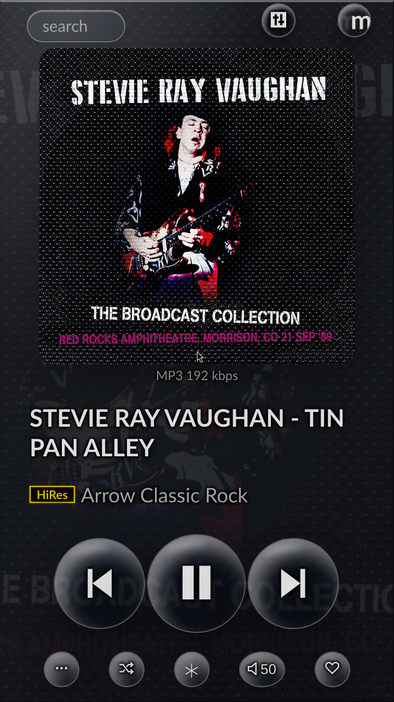
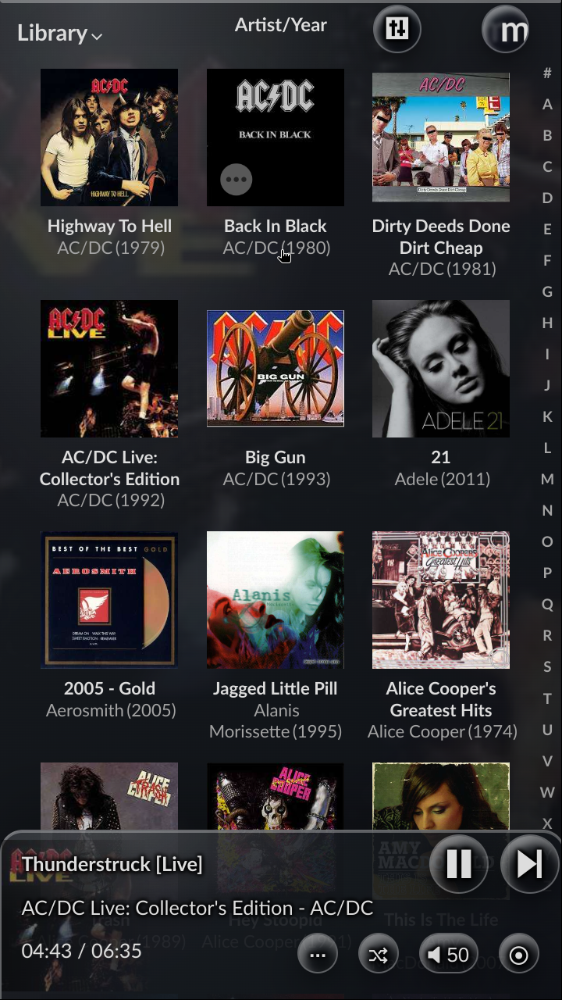
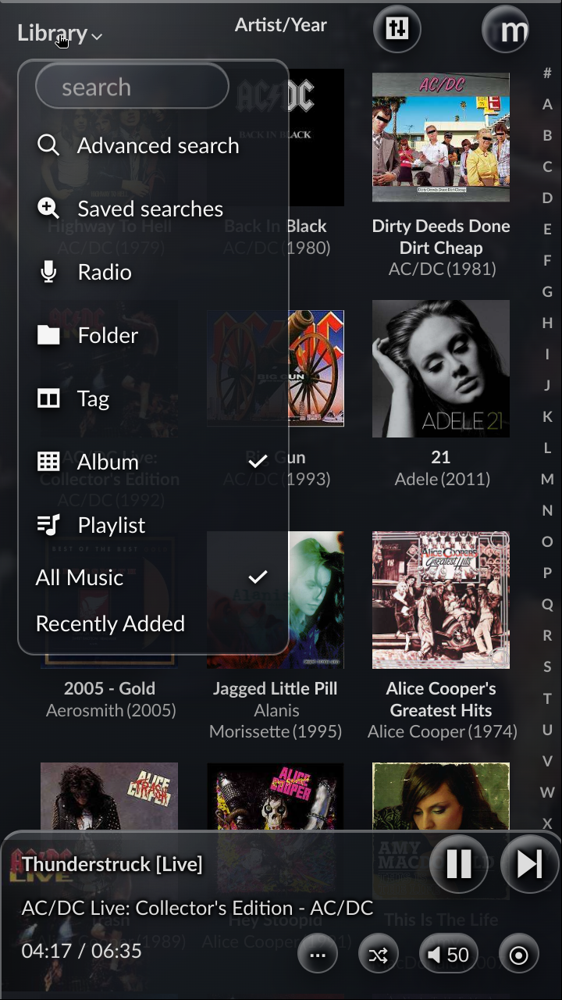

# Dark Glass theme for moOde Audio

This patch adds **Dark Glass** to moOde's existing theme selector. It provides
transparent rounded surfaces, tint-free glass controls, readable metadata over
cover artwork, lightweight glass menus, optimized Library scrolling, and a matching transparent focus
style when the optional SiriRemote navigation patch is installed. The Album,
Radio, Playlist, Folder, and Tag views retain moOde's native compact playbar
layout, while ordinary action buttons, Play/Pause, Next, volume, and toggle
controls use the same raised, tint-free glass material as the fullscreen
Playback controls. Text and symbols receive matching contrast shadows so they
remain legible over light and detailed cover artwork. Footer controls
and fullscreen compact toggle controls use explicit square boxes. The desktop
Previous/Play/Next controls also use fixed square boxes, preventing circular
buttons from becoming vertically oval on wider phone, tablet, and computer
layouts. On Playback, these controls act as true glass lenses: they show a
sharp, pixel-aligned continuation of moOde's cover backdrop while the page
behind them remains blurred. Stronger asymmetric refraction, rim lighting, and
depth shadows give both the transport and compact controls a convex appearance
without placing an opaque tint over the artwork. When SiriRemote is installed,
the persistent round controls use the same rim strength, highlight shape, and
light/dark depth balance as its overlay; unlike that overlay, their own fill
remains transparent so the surrounding playbar or header supplies the dark
base colour. Highlight blur and shadow distances are scaled to each control's
diameter, preventing small buttons from looking whiter than the much larger
overlay. Wide-screen footer controls are vertically centered and kept within
the footer instead of touching or crossing the viewport edge. The compact
fullscreen toggle row uses smaller true circles on landscape displays so it
also remains fully visible when browser chrome reduces the viewport height.
The persistent moOde and CamillaDSP header menus use the same circular glass
geometry in Playback and Library views. Album-footer transport controls have
locked square dimensions and cannot be compressed into vertical ovals by the
mobile flex layout.
The theme never overrides moOde's button visibility, so unavailable or disabled
layout actions stay hidden. Controls with a text label, such as Volume, may
remain wider capsules.

The project is independent of SiriRemote. It can be installed on a normal
moOde system and selected from **Preferences → Appearance → Theme**, just like
the themes supplied with moOde. Because the selected moOde theme is read from
the server, the styling applies both to the local display and to network
browsers on a phone, tablet, or computer. Reload an already-open browser once
after installation. SiriRemote's command feedback overlay is deliberately not
part of this theme and remains local to the Raspberry Pi display.


<br><sub>Playback with tint-free glass controls and readable metadata over moOde's cover backdrop.</sub><br><br>

<p>
  
  
</p>
<sub>Current neutral Dark Glass views: the optimized Album grid with responsive glass playbar, and the normally opened static-glass Library menu. Neither image contains a temporary SiriRemote focus state.</sub><br><br>

## What the patch changes

The installer:

1. adds one `Dark Glass` row to moOde's `cfg_theme` table;
2. installs `dark-glass-theme.css` and `dark-glass-theme.js` below
   `/var/www`;
3. adds one clearly marked CSS/JavaScript include block to
   `/var/www/header.php`;
4. stores the previously active theme and selects Dark Glass by default;
5. creates timestamped safety backups below
   `/var/backups/moode-dark-glass-theme`.

No additional package is installed. The CSS is applied only while moOde's
active theme is `Dark Glass`; choosing another theme in the GUI immediately
disables it. The database row supplies the standard moOde base colours, while
the separate stylesheet provides effects that cannot be represented by
moOde's four native theme colour fields. Playback and Library share the same
cover-art backdrop visibility, so moving between both views no longer makes
the artwork darker. The CamillaDSP and moOde menu controls are slightly
smaller than the native header height, remain fully inside the bar, and center
the `m` brand independently of moOde's original padded positioning. While a
Library grid is visible, the
theme keeps its glass gradients, rims, and shadows but suspends live backdrop
blur on the fixed header, footer, and footer buttons. This avoids repeatedly
re-blurring the moving album grid and makes touch scrolling more consistent.
Dropdown menus use opaque-enough static gradients, strong text contrast, and
no live backdrop blur, so their appearance does not add scrolling overhead.
Native select popups use an explicit high-contrast row palette, while moOde's
custom Theme chooser retains each theme's own background/text preview colours.
This keeps both light previews such as Green Tea and dark previews readable.
The fixed Library playbar likewise uses a static dark glass fill: underlying
album labels cannot interfere with its metadata or controls, without requiring
the moving album grid to be blurred every frame.
On narrow phone layouts every button in the compact footer action row uses the
same fixed height; labelled controls such as Volume may only grow horizontally.

## Install

```sh
git clone https://github.com/mischamol/moOdeAudioProjects.git
cd moOdeAudioProjects/DarkGlassTheme
sudo sh ./install.sh
```

To register the theme without selecting it immediately:

```sh
sudo sh ./install.sh --no-activate
```

Open **Preferences → Appearance → Theme** and select **Dark Glass**. Reload a
network browser if it was already open. The local display is reloaded by the
installer.

After a moOde update, run the same installer again. It is idempotent and
reapplies only its own marked include block and database entry.

## Maintenance and validation

The small JavaScript companion only synchronizes the selected theme and the
visibility of the Library view. All visual effects are defined in the
stylesheet; there is no second JavaScript cover-projection path to keep in
sync. The header patcher generates its supported asset-version history from a
single version number, so a new release requires changing only
`ASSET_VERSION`.

Before publishing a change, run:

```sh
node --check dark-glass-theme.js
python3 -m unittest test_patch_header.py
```

The screenshots above were recaptured from the local 720 × 1280 moOde display
after the current files had been installed.

## Uninstall

```sh
cd moOdeAudioProjects/DarkGlassTheme
sudo sh ./uninstall.sh
```

If Dark Glass is active, the uninstaller restores the theme that was active
before the first installation (or `Default` if that theme no longer exists).
It removes only its own two web assets, marked header block, database row, and
small previous-theme state file. Safety backups are retained.

## Compatibility

The patch supports both moOde source headers containing `scripts-panels.js` and
release headers containing the bundled `main.min.js`. It was developed against
moOde on Raspberry Pi OS Trixie and a 720 × 1280 portrait local display. The
layout remains responsive and is not tied to that resolution.
