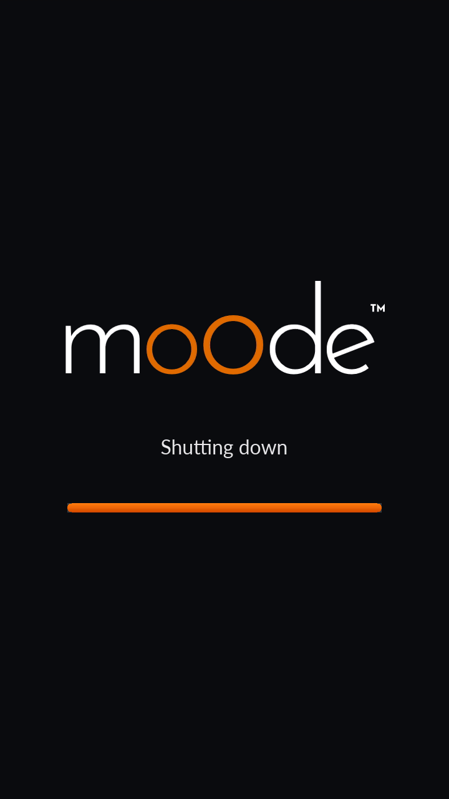

# moOde startup and shutdown screen

This optional patch adds a full-screen startup and shutdown screen to the
local Raspberry Pi display. It shows the official moOde logotype and an orange
progress bar on a dark background.




The screen is deliberately **not** implemented in X11 or Chromium. During the
early part of boot those are not available yet. The small Python program writes
RGB565 pixels directly to `/dev/fb0`, using the framebuffer that is already
provided by Raspberry Pi OS and the display driver. It does not change the
kernel, boot command line, or any moOde-owned web file, and it installs no new
packages.

Before drawing, the program switches from the verbose boot console on `tty1`
to unused `tty8` and places that terminal in Linux `KD_GRAPHICS` mode. This
temporarily detaches the framebuffer console (`fbcon`) from the visible pixels,
so kernel and systemd messages cannot alternately repaint the splash and cause
a flashing screen. Logging continues normally. X11 subsequently selects and
activates its own virtual terminal.

An early `sysinit` service starts the splash as soon as the local filesystems
and virtual console are available. It runs concurrently, so nginx, PHP-FPM,
MPD, and all other normal boot services are not held up. The startup bar
combines elapsed time with the actual readiness of nginx, PHP-FPM, and MPD.
When Xorg appears, the splash restores `tty8` to text mode and switches to the
VT selected by Xorg, allowing Chromium to start normally.

A separate, instant systemd coordinator exists only to obtain the correct
shutdown ordering. On a real reboot or power-off, systemd first stops the local
display and subsequently runs the shutdown animation. Merely restarting,
reinstalling, or uninstalling either service does not display a misleading
shutdown screen.

The earliest kernel or initramfs messages may still appear briefly before
Python and the framebuffer service can run. Hiding those too requires changing
the kernel command line (for example `quiet` and a lower `loglevel`), which this
patch deliberately does not do automatically.

The shutdown bar is time-based because systemd does not expose a meaningful
overall shutdown percentage.

## Requirements

- Raspberry Pi OS / moOde with a 16-bit RGB565 framebuffer at `/dev/fb0`
- `ffmpeg`, which is already part of the tested moOde installation
- an installed Lato or DejaVu Sans font

The installer checks these requirements before changing systemd.

## Install

```sh
git clone https://github.com/mischamol/moOdeAudioProjects.git
cd moOdeAudioProjects/StartupShutdownScreen
sudo sh ./install.sh
```

The installer is idempotent. The new screen is first visible during the next
boot and shutdown; restarting the service while X11 is active cannot provide a
representative preview because X11 owns the visible scanout at that point.

## Verify

```sh
systemctl is-enabled moode-startup-shutdown-screen
systemctl is-enabled moode-startup-screen
systemctl status moode-startup-shutdown-screen --no-pager
systemctl status moode-startup-screen --no-pager
journalctl -u moode-startup-shutdown-screen -b --no-pager
journalctl -u moode-startup-screen -b --no-pager
```

To render directly to the framebuffer while X11 is stopped, for example during
development, use:

```sh
sudo /usr/local/bin/moode-startup-shutdown-screen shutdown --duration 5
```

Do not run this preview over a working X11 session: both programs would write
to the same display.

## Uninstall

```sh
cd moOdeAudioProjects/StartupShutdownScreen
sudo sh ./uninstall.sh
```

The uninstaller removes only this service, executable, and copied logo.

## Files installed

- `/usr/local/bin/moode-startup-shutdown-screen`
- `/usr/local/share/moode-startup-shutdown/moode-logotype.png`
- `/etc/systemd/system/moode-startup-shutdown-screen.service`
- `/etc/systemd/system/moode-startup-screen.service`

After a moOde update, rerun the installer if the service is no longer enabled.
